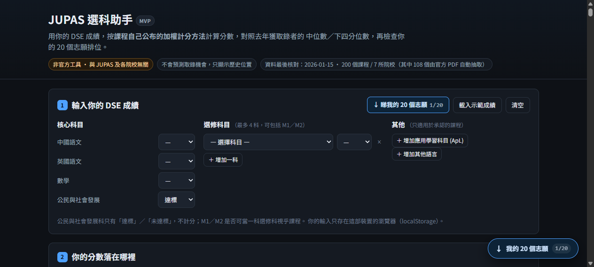
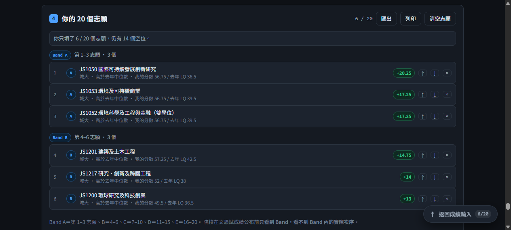

# JUPAS 選科助手 — JUPAS Subject Choice Helper

**Product by Jake Sze** · [](#tests) 

輸入你的 DSE 成績 → 按**每科課程自己公布的加權計分方法**計算分數 → 對照去年獲取錄者的
中位數／下四分位數 → 檢查你的 20 個志願排位（Band A–E）。

Enter your HKDSE grades, get every programme scored by **its own published
formula and weightings**, see where you sit against last cycle's admitted median
and lower quartile, and check the ordering of your 20 JUPAS choices.




> **非官方工具 · Not official.** Not affiliated with JUPAS, any university, the
> HKEAA or the EDB. It does not read or modify a real JUPAS application. Scores
> describe a position relative to last cycle's admitted students — they are
> **not** a chance of admission and **not** this year's threshold.

## Contents

- [Use it](#use-it) · [Run locally](#run-locally) · [Tests](#tests)
- [Coverage](#coverage) — 9 institutions configured, 200 programmes loaded
- [Why some data is missing](#why-some-data-is-missing) — nothing is estimated
- [Applied Learning (Category B)](#applied-learning-category-b)
- [Rebuilding the extracted data](#rebuilding-the-extracted-data)
- [Licence and data ownership](#licence-and-data-ownership)

## Use it

The app is static — classic `<script>` tags, no build step, no server, no
network calls. Any static host works.

**GitHub Pages (this repo):** Settings → Pages → Source: *Deploy from a branch* →
Branch: `main`, folder: `/ (root)` → Save. It is live at
`https://<your-username>.github.io/<repo-name>/` in about a minute. `.nojekyll` is
already present so Pages serves the files as-is.

**Offline / single file:** `node build.mjs` produces
`dist/jupas-mvp-standalone.html` — one self-contained file you can email, put on a
USB stick, or open with no internet at all.

## Coverage

**All nine JUPAS participating institutions are configured** (conversion ladder,
Category B/C handling, entrance gate). **Seven have per-programme data**:

| Institution | Programmes | Score ladder | Data status | Source |
|---|---:|---|---|---|
| CityUHK 城大 | 58 | 5\*\*=8.5 | `verified` — formula + weightings + scores published | CityU 2026 JUPAS admission-score PDF |
| HKU 港大 | 42 | 5\*\*=8.5 | `verified` — formula + weightings + 6th-subject bonus (0.2) published | JUPAS aggregate (HKU section) |
| HKUST 科大 | 33 | 5\*\*=8.5 | `partial` — programme weightings & bonus rate not published | HKUST admissions-scores PDF |
| HKMU 都大 | 28 | **5\*\*=7** | `partial` — "Best 5", some weightings published | JUPAS aggregate (HKMU section) |
| EdUHK 教大 | 25 | **5\*\*=7** | `partial` — LQ/median column order reversed vs other institutions | JUPAS aggregate (EdUHK section) |
| LU 嶺大 | 13 | **5\*\*=7** | `partial` — weighted scores published, per-subject weightings not | JUPAS aggregate (LU section) |
| CUHK 中大 | 1 | 5\*\*=8.5 | `partial` | CUHK IBBA programme page |
| PolyU 理大 | 0 | 5\*\*=8.5 | institution configured, **no rows** — see below | — |
| HKBU 浸大 | 0 | **not published** | institution configured, **no rows**, nothing scored | — |

**200 programmes total.** 6 are deliberately `blocked` (rule unreadable) and are
not scored at all.

### Why PolyU and HKBU have no per-programme rows

- **PolyU**: in the official aggregate PDF, the programme code, formula and score
  columns drift out of alignment across rows (merged cells). Row identity is lost,
  so any automated read would produce confident wrong numbers. Needs PolyU's own
  "JUPAS Admissions Figures" parsed properly.
- **HKBU**: publishes grade profiles plus a mean score, with **no conversion
  table** — so it cannot be scored on any ladder without inventing one. Left null;
  the engine refuses to score rather than pick a ladder.
- **CUHK**: only 1 programme. CUHK's section pairs each row with a grade profile
  and a weighted total; the parse is not reliable enough yet.

## Run locally

```bash
start index.html            # no build step: classic scripts, works over file://
python -m http.server 8080  # or serve it
node build.mjs              # single-file build -> dist/jupas-mvp-standalone.html
node --test tests/engine.test.mjs
```

## Tests

**34 tests, all passing.** Arithmetic is hand-computed from the published rules
and asserted exactly — weighted best-5, 3-core+2-elective, the Maths/M1-M2
exclusivity rule, the 7-point vs 8.5-point ladder difference, HKU's published 0.2
sixth-subject bonus, Category B points and the one-ApL rule — plus roster-integrity
checks (every record carries a dated source; `blocked` implies a reason; history is
never half-filled; median ≥ lower quartile) and a guard that a record is never
scored on a ladder its institution has not published.

## Layout

```
index.html                  classic <script> tags — runs from file://
css/app.css
js/engine.js                pure scoring engine (dual-export: browser + CommonJS)
js/data/subjects.js         Category A subject catalogue
js/data/apl.js              Category B (Applied Learning) catalogue — HKEAA
js/data/institutions.js     nine institutions: ladder, Cat B/C, gate, conventions
js/data/programmes.js       CityU / HKUST / CUHK rows (hand-entered, sourced)
js/data/programmes-ext.js   HKU / HKMU / EdUHK / LU rows (extracted, validated)
js/app.js                   UI only — calls the engine, does no arithmetic
tests/engine.test.mjs       34 tests
tools/generate.py           per-institution parse + validation
tools/emit.py               emits js/data/programmes-ext.js
build.mjs                   single-file build
docs/data-sources.md        provenance, blocked rows, annual update workflow
NOTICE.md                   data ownership and attribution
```

## Rebuilding the extracted data

The 108 rows for HKU / HKMU / EdUHK / LU were extracted from the official JUPAS
aggregate publication, not typed by hand:

```bash
cd tools
curl -sL -o af.pdf "https://www.jupas.edu.hk/f/page/3667/af_2025_JUPAS.pdf"
pdftotext -table af.pdf af_table.txt      # -table preserves the column bands
python generate.py                        # per-institution parse + validation
python emit.py                            # -> js/data/programmes-ext.js
```

`generate.py` reads each institution's section with its own rule (column bands
derived from the file, LQ-then-median order for EdUHK, above-the-code median for
LU) and **validates structurally before emitting**: a row is only kept when the
published columns satisfy UQ ≥ median ≥ LQ (or median ≥ LQ where two columns are
given). Sections that fail are reported and dropped.

The same heuristic reproduced 55 of 57 CityU rows from that PDF exactly, checked
against CityU's own publication — that is why it is trusted for the others.

## Applied Learning (Category B)

Supported, with the published limits:

- The picker carries all **64 Category B courses** from HKEAA's subject-information
  page, grouped by the six areas of studies, with the examination years each
  course runs (source: HKEAA, last checked 2026-01-15).
- Points follow HKEAA's own comparability statement: **Distinction (II) = 4**,
  **Distinction (I) = 3**, Attained = 0.
- **Only one ApL subject ever counts** — it can fill at most one elective slot, so
  if two are entered the better result is kept and the other is dropped with an
  explanation.
- An ApL subject is only counted for programmes that state they recognise
  Category B, and only where the institution says so.
- **ApL Chinese (for non-Chinese speaking students) is never scored** — no
  conversion is published, and some institutions exclude it outright.
- When an ApL subject actually lands in the counted set, the programme is marked
  `partial` and the caveat is printed: universities recognise only *specified* ApL
  subjects, and those per-programme lists are not published, so the score could be
  too high if the student's course is not on the list.

## Known limits (deliberate)

- HKU / EdUHK programme **titles** wrap across lines in the source, so some are
  truncated fragments. The JUPAS code is always correct — search by code.
- LU's median sits on the line above its code in the source; the parse is
  monotonicity-checked, but LU is the least certain section (13 rows kept).
- 6 blocked rows (4 CityU, 2 HKU) keep their history and compute nothing.
- Programme-specific minimum requirements are not captured; only institutional
  gates (332A33 for HKUST, 332A2 for CUHK/CityU) are. Other institutions show
  "未收錄" rather than a made-up gate.
- Category C (other languages) is only counted for CUHK/HKUST/CityU, whose tables
  are published; elsewhere it is excluded rather than guessed.
- Band A applicant counts per programme are not collected.

## Licence and data ownership

- **Code: MIT** © 2026 Jake Sze — see [`LICENSE`](LICENSE).
- **Data: not ours.** The programme rules, score tables, conversion ladders and
  subject lists are owned by JUPAS, the nine participating institutions, the HKEAA
  and the EDB. They are quoted here so a student can check their own eligibility,
  with the source and check-date stamped on every record. Read
  [`NOTICE.md`](NOTICE.md) before reusing them; several sources state that
  reproduction without written consent may be incomplete or misleading.
- This repository deliberately does **not** ship the extracted text of the source
  PDFs — only the parser (`tools/`) — so a clone is not a redistribution of their
  publications.
- **Not affiliated with JUPAS, any university, the HKEAA or the EDB.** JUPAS,
  HKDSE and institution names are trademarks of their respective owners, used
  descriptively.

## Contributing

The highest-value contributions are **data, not code**:

1. **PolyU** — parse "JUPAS Admissions Figures" into `js/data/` (about 46
   programmes). Its weighted totals use a much larger numeric range than other
   institutions, so keep it on its own axis.
2. **CUHK** — the full section, with per-programme weightings.
3. **Programme-specific minimum requirements** — the layer above the institutional
   gate (named electives, interviews, portfolios).
4. **HKBU's conversion table**, if it is published anywhere, to unblock that
   institution.

Whatever you add: keep the dated source on the record, and do not fill in a rule
you cannot read. If a formula is unreadable from the source, mark the record
`blocked` — that is a feature, not a gap.
