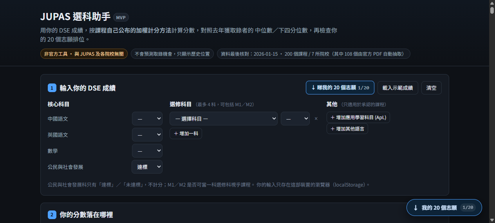
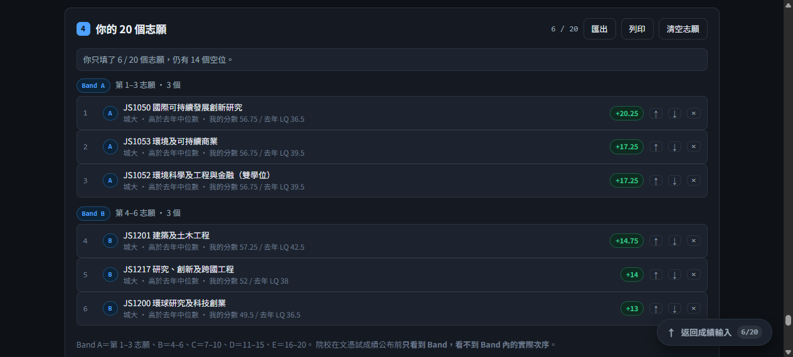

# JUPAS 選科助手 — JUPAS Subject Choice Helper

**Product by Jake Sze** · [](#tests) 

輸入你的 DSE 成績 → 按**每科課程自己公布的加權計分方法**計算分數 → 對照去年獲取錄者的
中位數／下四分位數 → 檢查你的 20 個志願排位（Band A–E）。

Enter your HKDSE grades, get every programme scored by **its own published
formula and weightings**, see where you sit against last cycle's admitted median
and lower quartile, and check the ordering of your 20 JUPAS choices.




> **非官方工具 · Not official.** Not affiliated with JUPAS, any university, the
> HKEAA or the EDB. It does not read or modify a real JUPAS application. Scores
> describe a position relative to last cycle's admitted students — they are
> **not** a chance of admission and **not** this year's threshold.

## Contents

- [Use it](#use-it) · [Run locally](#run-locally) · [Tests](#tests)
- [Coverage](#coverage) — 16 institutions, 422 programmes
- [Why some data is missing](#why-some-data-is-missing) — nothing is estimated
- [Applied Learning (Category B)](#applied-learning-category-b)
- [Rebuilding the extracted data](#rebuilding-the-extracted-data)
- [Licence and data ownership](#licence-and-data-ownership)

## Use it

The app is static — classic `<script>` tags, no build step, no server, no
network calls. Any static host works.

**GitHub Pages (this repo):** Settings → Pages → Source: *Deploy from a branch* →
Branch: `main`, folder: `/ (root)` → Save. It is live at
`https://<your-username>.github.io/<repo-name>/` in about a minute. `.nojekyll` is
already present so Pages serves the files as-is.

**Offline / single file:** `node build.mjs` produces
`dist/jupas-mvp-standalone.html` — one self-contained file you can email, put on a
USB stick, or open with no internet at all.

## Coverage

**16 institutions, 422 programmes**, all rebuilt from 學友社《中六升學指南 2026》.

| Institution | Programmes | Reference used | Comparable? |
|---|---:|---|---|
| CUHK 中大 | 65 | median + LQ + published weightings | yes |
| CityU 城大 | 60 | median + LQ, weights ×1.25/×1.5 (new 2027 method) | yes |
| HKU 港大 | 59 | UQ/M/LQ, weights printed before the subject | yes |
| HKMU 都大 | 51 | 28 JUPAS (M/LQ) + 22 SSSDP (listed only) | partly |
| PolyU 理大 | 47 | weighted mean, but weightings are on Study@PolyU | **no — says so** |
| HKUST 科大 | 34 | M/LQ + per-subject weights | yes |
| EdUHK 教大 | 26 | quartiles already weighted, weights not printed | **no — says so** |
| HKBU 浸大 | 23 | weighted **mean** only (5\*\*=7, the 7-point ladder) | vs the mean |
| LU 嶺大 | 20 | weighted **median** only, no LQ column | vs the median |
| SSSDP ×7 (高科院 11, 東華 8, 恒大 6, 聖方濟各 6, 樹仁 3, 伍倫貢 2, 珠海 1) | 37 | no conversion table published on those pages | **no — never scored** |

279 of the 422 rows have a reference this tool can reproduce, and therefore compare
against. The rest are shown with their published numbers **and an explicit reason** —
the app never invents a comparison it cannot justify.

### Why some institutions are listed but not scored

Institutions do not publish comparable things, and the app refuses to bridge the gap
with an assumption:

- **理大** publishes 入學平均分數（含科目比重） but keeps 科目比重 on Study@PolyU, so the
  printed mean is on a scale this tool cannot reproduce.
- **教大** publishes quartiles marked 「已包含加權分數」 but does not print the weights.
- **SSSDP / self-financing pages** print no 入學分數換算表 at all, so no ladder exists
  to score on. They appear with quotas, Band A counts and competition ratios only.

Each of these is labelled in the UI rather than silently approximated.

## Run locally

```bash
start index.html            # no build step: classic scripts, works over file://
python -m http.server 8080  # or serve it
node build.mjs              # single-file build -> dist/jupas-mvp-standalone.html
node --test tests/engine.test.mjs
```

## Tests

**38 tests, all passing.** Arithmetic is hand-computed from the published rules
and asserted exactly — weighted best-5, 3-core+2-elective, the Maths/M1-M2
exclusivity rule, the 7-point vs 8.5-point ladder difference, HKU's published 0.2
sixth-subject bonus, Category B points and the one-ApL rule — plus roster-integrity
checks (every record carries a dated source; `blocked` implies a reason; history is
never half-filled; median ≥ lower quartile) and a guard that a record is never
scored on a ladder its institution has not published.

## Layout

```
index.html                  classic <script> tags — runs from file://
css/app.css
js/engine.js                pure scoring engine (dual-export: browser + CommonJS)
js/data/subjects.js         Category A subject catalogue
js/data/apl.js              Category B (Applied Learning) catalogue — HKEAA
js/data/institutions.js     nine institutions: ladder, Cat B/C, gate, conventions
js/data/programmes.js       CityU / HKUST / CUHK rows (hand-entered, sourced)
js/data/programmes-ext.js   legacy rows from the official aggregate (superseded)
js/data/programmes-2027*.js per-institution 2027 layer from 學友社 guide
                            (cityu, cuhk, hku, hkust, hkbu, lu, polyu, eduhk,
                             hkmu, + sssdp: sfu, chc, hsuhk, twc, thei, uow, hksyu)
js/app.js                   UI only — calls the engine, does no arithmetic
tests/engine.test.mjs       38 tests
tools/generate.py           per-institution parse + validation
tools/emit.py               emits js/data/programmes-ext.js
build.mjs                   single-file build
docs/data-sources.md        provenance, blocked rows, annual update workflow
NOTICE.md                   data ownership and attribution
```

## Rebuilding the extracted data

The 108 rows for HKU / HKMU / EdUHK / LU were extracted from the official JUPAS
aggregate publication, not typed by hand:

```bash
cd tools
curl -sL -o af.pdf "https://www.jupas.edu.hk/f/page/3667/af_2025_JUPAS.pdf"
pdftotext -table af.pdf af_table.txt      # -table preserves the column bands
python generate.py                        # per-institution parse + validation
python emit.py                            # -> js/data/programmes-ext.js
```

`generate.py` reads each institution's section with its own rule (column bands
derived from the file, LQ-then-median order for EdUHK, above-the-code median for
LU) and **validates structurally before emitting**: a row is only kept when the
published columns satisfy UQ ≥ median ≥ LQ (or median ≥ LQ where two columns are
given). Sections that fail are reported and dropped.

The same heuristic reproduced 55 of 57 CityU rows from that PDF exactly, checked
against CityU's own publication — that is why it is trusted for the others.

## Applied Learning (Category B)

Supported, with the published limits:

- The picker carries all **64 Category B courses** from HKEAA's subject-information
  page, grouped by the six areas of studies, with the examination years each
  course runs (source: HKEAA, last checked 2026-01-15).
- Points follow HKEAA's own comparability statement: **Distinction (II) = 4**,
  **Distinction (I) = 3**, Attained = 0.
- **Only one ApL subject ever counts** — it can fill at most one elective slot, so
  if two are entered the better result is kept and the other is dropped with an
  explanation.
- An ApL subject is only counted for programmes that state they recognise
  Category B, and only where the institution says so.
- **ApL Chinese (for non-Chinese speaking students) is never scored** — no
  conversion is published, and some institutions exclude it outright.
- When an ApL subject actually lands in the counted set, the programme is marked
  `partial` and the caveat is printed: universities recognise only *specified* ApL
  subjects, and those per-programme lists are not published, so the score could be
  too high if the student's course is not on the list.

## Known limits (deliberate)

- HKU / EdUHK programme **titles** wrap across lines in the source, so some are
  truncated fragments. The JUPAS code is always correct — search by code.
- LU's median sits on the line above its code in the source; the parse is
  monotonicity-checked, but LU is the least certain section (13 rows kept).
- 6 blocked rows (4 CityU, 2 HKU) keep their history and compute nothing.
- Programme-specific minimum requirements are not captured; only institutional
  gates (332A33 for HKUST, 332A2 for CUHK/CityU) are. Other institutions show
  "未收錄" rather than a made-up gate.
- Category C (other languages) is only counted for CUHK/HKUST/CityU, whose tables
  are published; elsewhere it is excluded rather than guessed.
- Band A applicant counts per programme are not collected.

## Licence and data ownership

- **Code: MIT** © 2026 Jake Sze — see [`LICENSE`](LICENSE).
- **Data: not ours.** The programme rules, score tables, conversion ladders and
  subject lists are owned by JUPAS, the nine participating institutions, the HKEAA
  and the EDB. They are quoted here so a student can check their own eligibility,
  with the source and check-date stamped on every record. Read
  [`NOTICE.md`](NOTICE.md) before reusing them; several sources state that
  reproduction without written consent may be incomplete or misleading.
- This repository deliberately does **not** ship the extracted text of the source
  PDFs — only the parser (`tools/`) — so a clone is not a redistribution of their
  publications.
- **Not affiliated with JUPAS, any university, the HKEAA or the EDB.** JUPAS,
  HKDSE and institution names are trademarks of their respective owners, used
  descriptively.

## Contributing

The highest-value contributions are **data, not code**:

1. **PolyU** — parse "JUPAS Admissions Figures" into `js/data/` (about 46
   programmes). Its weighted totals use a much larger numeric range than other
   institutions, so keep it on its own axis.
2. **CUHK** — the full section, with per-programme weightings.
3. **Programme-specific minimum requirements** — the layer above the institutional
   gate (named electives, interviews, portfolios).
4. **HKBU's conversion table**, if it is published anywhere, to unblock that
   institution.

Whatever you add: keep the dated source on the record, and do not fill in a rule
you cannot read. If a formula is unreadable from the source, mark the record
`blocked` — that is a feature, not a gap.
